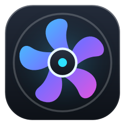

 

# Ray Cool

**Версия 1.1.0**

Программа для Windows 10/11 (x64): управление вентиляторами по кривым и RGB-подсветкой в одном окне.

В этом репозитории лежат только готовые сборки — см. [Releases](../../releases).

## Возможности

- Датчики температуры, обороты, графики за период до 7 дней.
- Кривые вентиляторов с гистерезисом, профили, горячие клавиши, автопереключение по запущенным программам.
- Защита: аварийный порог температуры, минимум для помпы и кулера процессора, отдельный процесс-страж.
- Подсветка через OpenRGB: статичные и анимированные эффекты, реакция на температуру, звук и экран.
- Лаунчер с проверкой обновлений.

## Установка

1. Скачайте архив `RayCool-<1.1.0>.zip` из последнего релиза и распакуйте, например, в `C:\Program Files\RayCool`.
2. Запустите `RayCool.Launcher.exe`. Программе нужны права администратора.
3. Откройте «Настройки» → «Компоненты» и установите недостающее кнопкой «Установить»:
   - **PawnIO** — драйвер для датчиков материнской платы и управления вентиляторами;
   - **OpenRGB** — нужен для подсветки.

   Компоненты ставятся из официального каталога winget. Среда .NET встроена в программу, отдельно её ставить не нужно.

Сборки не подписаны цифровой подписью, поэтому Windows SmartScreen может показать предупреждение.

## Обновления

Лаунчер при запуске сам проверяет новые версии в этом репозитории и предлагает обновиться. Архив перед установкой сверяется по контрольной сумме SHA-256.

## Предупреждение

Программа напрямую управляет вентиляторами и помпой. Неправильные настройки могут привести к перегреву. Вы используете её на свой страх и риск.

## Сторонние компоненты

В состав сборки входят среда [.NET](https://github.com/dotnet/runtime) (MIT) и библиотеки под своими лицензиями:
[LibreHardwareMonitor](https://github.com/LibreHardwareMonitor/LibreHardwareMonitor) (MPL-2.0),
[OpenRGB.NET](https://github.com/diogotr7/OpenRGB.NET) (MIT),
[WPF-UI](https://github.com/lepoco/wpfui) (MIT),
[ScottPlot](https://github.com/ScottPlot/ScottPlot) (MIT),
[NAudio](https://github.com/naudio/NAudio) (MIT),
[Vortice.Windows](https://github.com/amerkoleci/Vortice.Windows) (MIT),
[Serilog](https://github.com/serilog/serilog) (Apache-2.0),
[CommunityToolkit.Mvvm](https://github.com/CommunityToolkit/dotnet) (MIT).

PawnIO и OpenRGB в сборку не входят: это отдельные программы, которые устанавливаются с их официальных источников.
